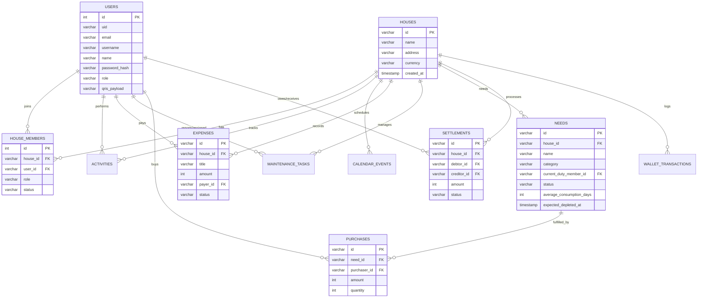

# Struktur Database: KontrakanKu

Berikut adalah visualisasi struktur dan relasi seluruh tabel (mirip dengan tampilan *Designer* di phpMyAdmin), beserta daftar lengkap tipe datanya yang ditarik secara langsung dari lokal MySQL Anda.

## Entity-Relationship Diagram (ERD)

## Detail Tabel & Kolom (Data Dictionary)

### 1. `users` (Pengguna / Penghuni)
Tabel ini menyimpan data rahasia (*credentials*) untuk login dan profil member.
*   **`id`** (INT, PK, Auto Increment)
*   **`uid`** (VARCHAR): String ID publik (contoh: `user_ghozi`).
*   **`email`** (VARCHAR): Email (unik).
*   **`username`** (VARCHAR): Username pendek (contoh: `ghozi`).
*   **`password_hash` & `password_salt`**: Kata sandi terenkripsi aman (SHA-512 + Salt).
*   **`name`** (VARCHAR): Nama lengkap.
*   **`qris_payload`** (VARCHAR): Payload QRIS Dinamis unik milik pengguna tersebut untuk transfer dana.
*   **`role`** (VARCHAR): Role *default* (`member`, `super_admin`).

### 2. `houses` (Data Kontrakan/Rumah)
*   **`id`** (VARCHAR, PK)
*   **`name`** (VARCHAR)
*   **`address`** (VARCHAR)
*   **`currency`** (VARCHAR): Default `IDR`.

### 3. `house_members` (Relasi User - Rumah)
Menghubungkan `users` dengan `houses` karena satu user bisa berada di banyak rumah.
*   **`house_id`** (VARCHAR, FK)
*   **`user_id`** (VARCHAR, FK)
*   **`role`** (VARCHAR): Peran dalam rumah (owner, admin, member).
*   **`status`** (VARCHAR): `active` / `inactive`.

### 4. `needs` (Kebutuhan Rutin & Barang)
Tabel canggih penyimpan stok, inventaris, dan galon/gas.
*   **`id`** (VARCHAR, PK)
*   **`name`**, **`icon`**, **`category`**
*   **`duty_enabled`** (BOOLEAN): Apakah barang ini memerlukan rotasi piket isi ulang.
*   **`current_duty_member_id`**: Member yang saat ini wajib isi ulang.
*   **`status`**: `AVAILABLE`, `DEPLETED`, dll.
*   **`expected_depleted_at`** (TIMESTAMP): Hitungan matematis prediksi kapan barang habis.
*   **`rotation_logic`**: Mode rotasi piket (`individual`, `all`).

### 5. `purchases` (Riwayat Pembelian Kebutuhan)
*   **`need_id`** (VARCHAR, FK)
*   **`purchaser_id`** (VARCHAR, FK)
*   **`amount`** (INT): Nominal Rupiah.
*   **`quantity`** (INT)

### 6. `expenses` (Split Bill & Patungan)
Menyimpan tagihan bersama yang belum dipecah ke perorangan.
*   **`id`** (VARCHAR, PK)
*   **`amount`** (INT): Total bon/tagihan.
*   **`payer_id`** (VARCHAR, FK): Siapa yang menalangi pertama kali.
*   **`status`**: `OPEN` atau `SETTLED`.
*   **`participants`** (VARCHAR): String JSON daftar orang yang ikut patungan.

### 7. `settlements` (Pelunasan Hutang Piutang)
*   **`debtor_id`** (VARCHAR): Yang Berhutang (Pengirim uang).
*   **`creditor_id`** (VARCHAR): Pemberi Hutang (Penerima uang).
*   **`amount`** (INT): Nominal.
*   **`status`**: `PENDING`, `PAYMENT_SUBMITTED`, `CONFIRMED`.

### 8. `maintenance_tasks` (Perbaikan / Kerusakan)
*   **`title`**, **`description`**
*   **`cost_estimate`** & **`actual_cost`** (INT)
*   **`reporter_id`** & **`assignee_id`**
*   **`status`**: `OPEN`, `IN_PROGRESS`, `RESOLVED`.

### 9. Tabel Historikal (Log)
*   **`activities`**: Mencatat semua jejak (*audit log*) "Siapa melakukan Apa pada Kapan".
*   **`wallet_transactions`**: Arus Kas masuk dan keluar (Kas Kontrakan).
*   **`calendar_events`**: Event atau jadwal bersih-bersih rumah bersama.
